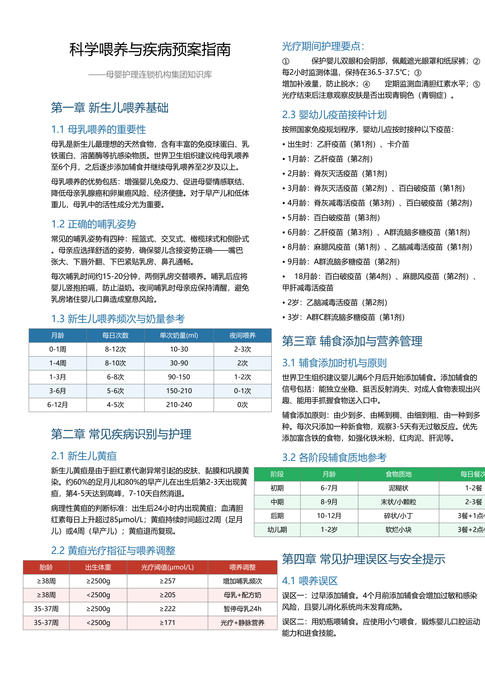
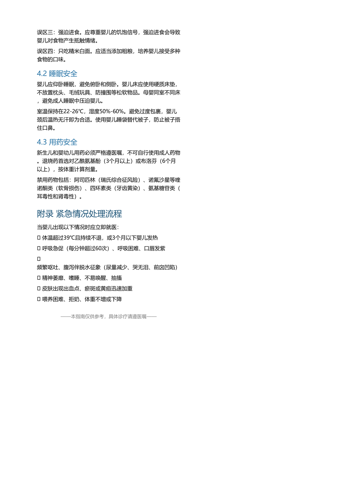

# 长文本版面分析RAG检索系统

母婴护理连锁机构集团知识库的千万级长文档语义检索系统。支持双栏排版识别、跨页表格提取、父子分块检索，在8GB显存上即可运行。

## 核心特性

- **版面分析**：坐标启发式双栏检测，正确处理双栏PDF阅读顺序
- **表格保留**：表格转Markdown完整保留，不切分、独立成块
- **父子分块**：300 tokens子文档做向量检索，1200 tokens父文档做LLM上下文
- **多向量检索**：Dense Retrieval + BGE-Reranker混合评分
- **FAISS ANN**：HNSW索引支持千万级向量毫秒级检索
- **本地部署**：嵌入(bge-m3) + 重排(BGE-Reranker) + 生成(qwen3:8b)全本地运行

## 技术栈

| 层级 | 技术选型 |
|------|----------|
| 前端 | Streamlit |
| 后端 | FastAPI + Uvicorn |
| PDF解析 | pdfplumber |
| 嵌入模型 | bge-m3 (Ollama) |
| 向量索引 | FAISS IndexHNSWFlat |
| 重排序 | BGE-Reranker-Large |
| LLM | qwen3:8b (Ollama) |

## 快速开始

### 1. 环境准备

```bash
# 创建conda环境
conda create -n pdfqa python=3.10 -y
conda activate pdfqa

# 安装依赖
pip install -r requirements.txt

# 安装Ollama并下载模型
ollama pull bge-m3:latest
ollama pull qwen3:8b

# 下载重排模型 BGE-Reranker-Large（首次运行前）
# 方式一：放到项目目录 models/bge-reranker-large/
# 方式二：设置环境变量 RERANKER_PATH 指向已有模型目录
```

### 2. 一键启动

```bash
scripts\start_all.bat
```

或分别启动：

```bash
# 终端1：后端 (端口8563)
scripts\start_backend.bat

# 终端2：前端 (端口8523)
scripts\start_frontend.bat
```

### 3. 使用流程

1. 打开 http://localhost:8523
2. 上传PDF文档 → 查看版面分析 → 构建索引 → 智能问答

## 项目结构

```
├── docs/                          # 项目文档
│   ├── 01-千万级母婴护理RAG语义分块方案.md
│   ├── 02-垂直领域知识提取与元数据规范.md
│   ├── 03-技术架构文档.md
│   ├── 04-用户手册.md
│   └── 05-操作手册-从开机到演示.md
├── tests/                         # 测试与评估
│   ├── conftest.py                # pytest共享fixture
│   ├── test_layout.py             # 版面分析测试
│   ├── test_chunking.py           # 分块测试
│   ├── test_retrieval.py         # 检索测试
│   ├── maternal_care_qa_50.json   # 50个标准问答对
│   ├── run_ragas_eval.py          # Ragas评估脚本
│   └── stress_test.py             # 千万级压测脚本
├── scripts/                       # 运维脚本
│   ├── start_all.bat              # 一键启动
│   ├── start_backend.bat          # 启动后端
│   ├── start_frontend.bat         # 启动前端
│   ├── build_index.py             # 索引构建CLI
│   └── setup_env.bat              # 环境初始化
├── frontend/                      # Streamlit前端
├── backend/                       # FastAPI后端
├── requirements.txt               # Python依赖
└── README.md
```

## 核心算法说明

### 父子分块策略

```
父文档(1200 tokens) ── 完整章节，作为LLM上下文
  ├── 子文档1(300 tokens) ── 向量检索单元
  ├── 子文档2(300 tokens) ── 向量检索单元（50 tokens重叠）
  └── 子文档3(300 tokens) ── 向量检索单元
```

检索流程：Query → 子文档向量检索 → 命中子文档 → 返回父文档上下文 → LLM生成

### 多向量混合评分

```
Score_final = 0.3 × Sim_Dense(Query, Child) + 0.7 × Sim_Rerank(Query, Parent)
```

### 压测命令

```bash
# 默认100万向量演示
python tests/stress_test.py

# 千万级测试（需40GB+内存）
python tests/stress_test.py --n-vectors 10000000 --index-type hnsw
```

## 效果图

**双栏版面分析**（坐标启发式检测，正确处理双栏阅读顺序）：



**跨页表格提取**（表格转 Markdown，不切分、独立成块）：



## 评估指标

| 指标 | 目标值 |
|--------------|
| Context Recall | ≥ 90% |
| Context Precision | ≥ 88% |
| P99检索延迟 | ≤ 200ms |
| QPS (并发50) | ≥ 80 |

运行评估：
```bash
python tests/run_ragas_eval.py
```
